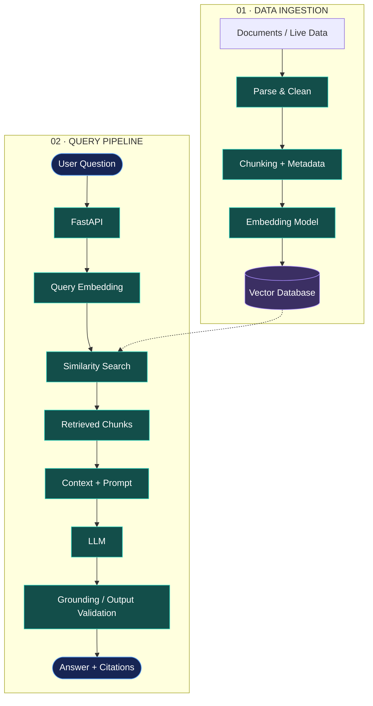

# Hi, I'm Armaghan 👋

### AI & Backend Engineer | Scalable Systems | AI Integration

I build **intelligent, reliable, and scalable backend systems** that solve real-world problems.

My work focuses on AI-powered applications, retrieval-augmented generation (RAG), API development, data processing, and workflow automation. I care about building systems that are not only functional, but also maintainable, secure, and production-ready.

- 🤖 Building AI-powered applications and RAG pipelines
- ⚙️ Developing backend services with Python, FastAPI, and Go
- 🔎 Working with LLM integrations, vector search, and real-time data synchronization
- 🗺️ Building data-driven platforms and automated workflows
- 🐳 Exploring scalable deployments, system architecture, and backend reliability

**Smart Models. Solid Systems.**

---

## 🧠 System Design & Architecture

I focus on designing systems with clear boundaries between APIs, business logic, AI services, background processing, and data storage.

### Example: RAG System Architecture

*Illustrative architecture demonstrating how ingestion and retrieval fit together in a RAG application.*

---

## 🛠️ Technical Stack

### Languages

### Backend Engineering

### AI & LLM Engineering

### Databases & Data

### Infrastructure & Automation

---

## 🚀 Areas of Work

| Area | Focus |
|---|---|
| AI Engineering | LLM integration, RAG, retrieval, context management |
| Backend Development | REST APIs, service architecture, validation, authentication |
| Data Systems | Database design, vector search, real-time synchronization |
| Workflow Automation | Event-driven workflows, integrations, background processing |
| Infrastructure | Docker, Linux, Nginx, deployment and server operations |

---

## 📌 What I Value

- **Clean architecture** — clear boundaries and maintainable code.
- **Reliability** — predictable behavior, validation, and meaningful error handling.
- **Security** — protecting data, credentials, and application boundaries.
- **Performance** — efficient database access, caching, and asynchronous processing.
- **Practical AI** — building AI features that solve real problems rather than adding AI without purpose.

---

## 🤝 Let's Connect

I'm interested in collaborating on AI-powered applications, backend platforms, RAG systems, and scalable software architecture.

---

  

